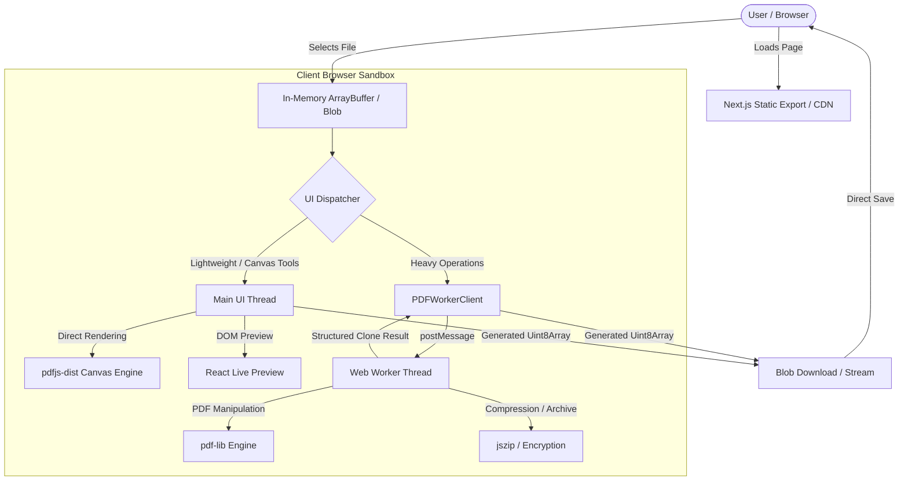

# Architecture Overview — ihatelovepdf

> **ihatelovepdf** is a privacy-first web application providing 35+ PDF utilities running **100% inside the user's browser**. Documents never leave the client device.

---

## 🏛️ High-Level System Architecture

---

## 🔑 Core Architecture Concepts

### 1. Zero-Server Static Export (`output: "export"`)
* Configured in [`next.config.ts`](../next.config.ts) with `output: "export"`.
* The entire website compiles to static HTML, CSS, JavaScript, WebAssembly, and font binaries located in `out/`.
* No Node.js server, lambda function, or backend database processes user documents in production.

### 2. Document Life Cycle & Memory Isolation
* Files uploaded via [`FileUploader.tsx`](../src/components/pdf-processor/FileUploader.tsx) are ingested as native browser `File` objects.
* Documents are converted to `ArrayBuffer` in memory and parsed into `PDFDocument` structures via `pdf-lib`.
* **Zero Disk Cache**: Temporary objects are allocated in browser heap memory and automatically reclaimed by browser garbage collection once the user downloads or resets the workspace.
* Large files (>100MB) are flagged with non-destructive memory warnings to prevent mobile tab termination.

### 3. Worker Offloading Pipeline (`PDFWorkerClient`)
* Web Worker communication is abstracted through a singleton class [`PDFWorkerClient`](../src/lib/worker-client.ts) in `src/lib/worker-client.ts`.
* Standard operations (`compress`, `merge`, `split`, `rotate`, `crop`, `extract`, `reorder`, `watermark`, `pageNumbers`, `headersFooters`, `encrypt`, `decrypt`, `pdfToImages`, `pdfToZip`) run on a dedicated worker thread ([`src/workers/pdf.worker.ts`](../src/workers/pdf.worker.ts)).
* The worker reports periodic progress percentages (`onProgress(percent, statusMessage)`), allowing the UI to render smooth progress indicators without blocking the main event loop.
* **Main Thread Fallback**: If a browser environment lacks worker support or throws an unexpected serialization error, operations automatically fall back to the main thread with warning telemetry.

### 4. Internationalization (i18n) & Localized Routing
* The app supports **9 locales**: `en`, `es`, `pt`, `de`, `fr`, `hu`, `it`, `ro`, `ru`.
* Route slugs are mapped in [`content/i18n-route-map.json`](../content/i18n-route-map.json).
* At build time, Next.js executes `generateStaticParams()` to pre-render 384+ static pages across all languages with automatic `hreflang` alternates and canonical tags.

### 5. Canvas Scale Limiting & Viewport Protection
* When rasterizing high-DPI PDFs to canvas (e.g. in thumbnail generation or diff comparisons), mobile browsers can crash if canvas dimensions exceed hardware texture limits.
* [`src/lib/canvas-limits.ts`](../src/lib/canvas-limits.ts) clamps scale factors and releases canvas memory immediately upon component unmount.
